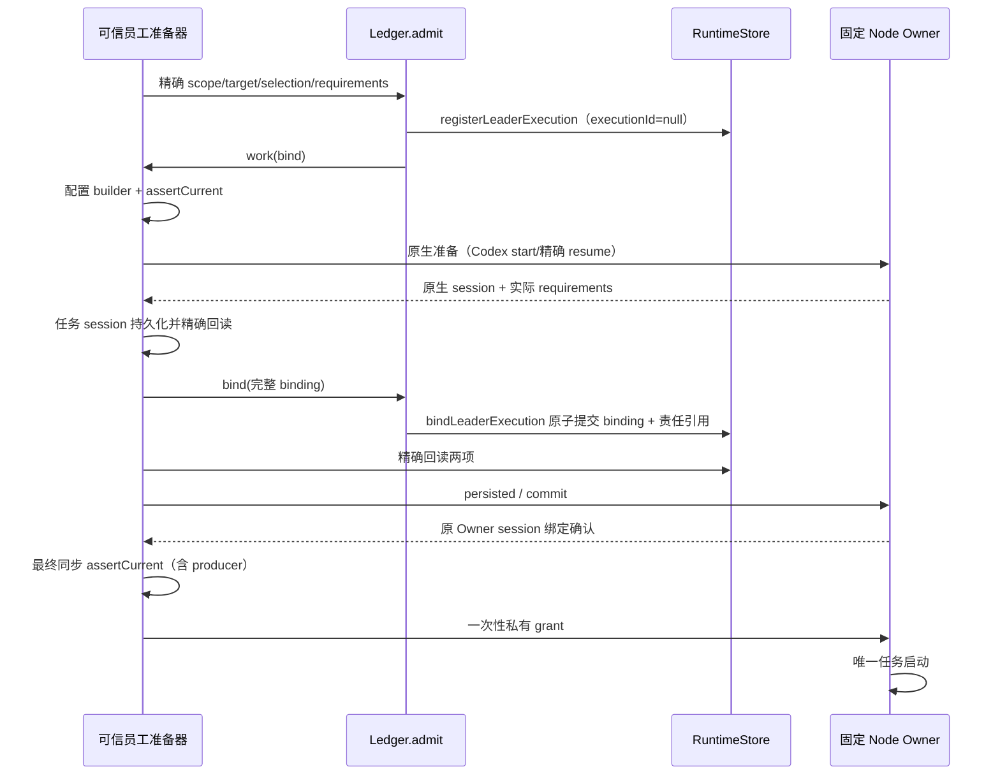

# 部门员工执行准入接线

状态：开发中。本专题只交付 OpenCode 进程链与 Codex 专属链对稳定执行集合合同的可信注入边界。生产 producer、组长协调执行与其它首次登记入口尚未装配；`observeLeaderCleanup` 仍为 `null`，不开放容量恢复或完整产研部模式。

## 责任与信任边界

事实来源是 `departmentemployeeexecutionadmission.ts`、两条 `department*preparation.ts`、`departmentleaderexecutionledger.ts` 和 `departmentruntimestore.ts`。员工 scope 与 target 由准备器核对权威 root/leader task、workspace、模块/角色路线、组织 generation、唯一 running subtask、实际 scheduler running attempt 和 leader/employee 容量租约后构造。模型 prompt、UI、task 中持久字段不能提供准入能力或自行指定这些身份。

`createDepartmentEmployeeExecutionAdmission(store, producer, policy)` 是仅供可信宿主调用的工厂。它返回不可序列化的内存对象，以私有 WeakMap 关联同一 Store、完整 `DepartmentLeaderExecutionProducer` 和 Ledger；伪造对象、反序列化对象或另一 Store 的能力均不能进入。它没有公共 socket/module/worker 执行入口，也不把一个布尔授权回调包装成 producer。可信代码仍须负责 producer 的真实性；WeakMap 不用于隔离恶意宿主代码。

后续组合根必须用真实 producer 在整代首次准备前 `Ledger.open(scope)`，覆盖协调执行与全部员工准入，并将返回的能力注入两个准备器的 `host.employeeAdmission`。本封装不 open/adopt 旧代次，不实现 closure，不从 task 状态推导 producer。当前 `extension.ts` 没有安装生产 producer，因此新准备在 builder 前报 `department-employee-admission-unavailable`，保留原责任和占用，不回退到 `bindExecution`。真实 producer 需要覆盖实际新准入、迟到 grant 与在途准备的栅栏/drain，不能用 completed、普通 Promise、定时器或空 Map 代替。

## 准备前固定策略

八字段 selection 沿用可信宿主选择：version、cli、role、configId、revision、model、thinkingMode、openCodeVariant。原配置 builder 和真实配置执行租约保持，指纹不能代替租约。

预登记 requirements 对照固定 worker 的真实资源策略：

| 资源 | Codex worker | OpenCode process worker |
| --- | --- | --- |
| processTerminal / streams | required | required |
| turnTerminal | required | not applicable（纯进程） |
| runner（原生 session）/ executionRoot / links / tab | required | required |
| temp | required（Owner 配置租约） | 由可信 overlay 策略固定 |

工厂的 `policy.processOverlay` 可为固定 `required`/`absent` 或由可信配置策略提供的同步 resolver。resolver 只接收冻结选择的副本，必须在 builder 前返回确切 boolean；不得从 worker 迟到结果或模型输入反推。返回值被固化，之后 builder 的 overlay 有无必须匹配，worker 的全部 requirements 也必须逐项匹配预登记。策略冲突拒绝，不降为不适用。后续 producer 装配须把这个 resolver 接到实际 overlay 配置选择，不能安装恒定猜值掩盖配置差异。

registrationId 用 root/workspace/leader/module/generation/subtask/attempt 的固定顺序 SHA256 生成，关联同一责任；selection 或 requirements 改变时仍由原 Store 拒绝冲突。相同 attempt 重入幂等，不同 attempt 保留各自责任，未绑定、准备失败、unsupported 或取消均不删除 null 项。

## 一次准入生命周期

两条准备链均通过 `admitDepartmentEmployeeExecution` 复用 Ledger.admit 和其 bind 回调，没有复制 Store 的 scope、selection、requirements 或不可变存储校验。封装补充原子提交后的完整 binding/责任引用回读；任一步失败不 commit/grant。原生准备、任务 session 持久化、原 Owner 绑定、取消与私有 IPC 协议沿用既有实现。

原准备器的 `assertCurrent` 在每个异步阶段和最终同步授权处复核权威任务、路线、generation、实际 attempt、租约及精确 session/binding，并加入准入仍 active、producer 仍 current 的检查。两条链先复制初始权威事实，防止异步准入等待期间原对象修改影响比较基准；时间戳、聊天或报告变化不误撤权。取消/撤权、私有断连及迟到 ACK 均不重发任务。最终 grant 是原取消线性化点；之后调用者退出或取消不能停止已授权 Owner。

Codex 的 admission 在 grant 确认后结束，业务 `owner.completion` 在其外继续等待，避免 producer 把合法 Owner 全部执行期视作启动准入。收到的异步消费仍由原 bootstrap/worker 真实确认；缺消费者、消费失败、原生不排空等保持 unknown，不制造成功。进程链返回原 handle/lifecycle；不改 Owner identity v1、slot fencing、launcher 或 runner。

已有精确绑定先校验当前 session/generation/selection 后仅观察原 Owner，不需要新能力，不创建替代 Owner 或重放 prompt。Codex 原一次准备 reservation 保留，模糊送达/失败不会换 thread。准入失败仍保留 null 或原 binding 和容量，没有回滚任务原生身份。

## 验证与未完成门禁

最小受影响验证使用实体隔离源码副本的标准 `npm run build`，以及 `node --test-concurrency=1 --test dist/test/runtime/departmentprocessbootstrap.test.js dist/test/runtime/departmentcodexbootstrap.test.js`。使用临时 Store、临时用户目录、固定免费 Node/模拟 CLI 和受控测试 producer；测试 producer 维护准入/撤权状态且明确拒绝产出 closure，不冒充生产 producer。

回归覆盖：builder 前及 worker fork 时可读责任；失败保留 null；原子绑定前零任务、成功后一次 grant；两条链同 subtask 多 attempt 独立登记/同 attempt 幂等；缺失或伪造能力；overlay 和 worker requirements 不符；绑定/任务持久失败；准备及 Owner 绑定等待取消、最终 producer 撤权、迟到 ACK；原配置租约和 grant 后 Owner 跨启动宿主退出存活。最终标准构建通过；两模块组合运行 81/82，唯一失败为恢复宿主使用旧父进程 Map 的 fixture 问题，改为先断言陈旧状态拒绝、再冷读真实持久 task 后，单项 1/1 通过，合计覆盖 82 个不同用例。其余 81 项受测源码未变，直接复用，没有为凑全绿日志重跑。具体命令、日志与源码对账见本轮 attempt 报告。

round-215 的 52 项交互结果仅复用未改交互模块；旧私有 IPC/launcher 结果按未改协议范围复用，不能证明本次新增登记接线。既有 EH fixture 仅补注入同一受控能力以适配必需端口，本轮不运行 EH；旧 EH 正常/取消结果不覆盖新增 Ledger 语义。没有真实模型费用、完整用户交互、浏览器、Windows/Linux 实机或全量套件验证。

资源由原 Owner 持有。runner 原生 session 和 VS Code tab 缺可信释放能力仍 required/unobservable，不以任务结束、失败、超时或强制杀测试进程制造完整 receipt。生产 producer、真实组长/总监所有权、协调执行、session/tab 释放、容量凭证消费、全树 stop/continue、冷恢复与最终 UI 集成仍是后续门禁；本轮不修改清理聚合、并行 Owner fixture、cleanup 专题或 active 计划。

## 维护性与等待成本

共享封装只增加一个 capability WeakMap，键可回收；无新持久缓存、重试循环、计时成功或全历史 receipt 扫描。登记/原子绑定及 readback 沿用 Store 的线性验证和单 EH 写者假设；准备器原有每次异步复核成本保持，封装仅在原子绑定后加一次执行集合冷回读。原生准备、producer admission 和消费排空若不结算仍可能等待；责任与容量保持 unknown，后续真实 producer 必须承接这些在途责任，不可将超时当 drain。
